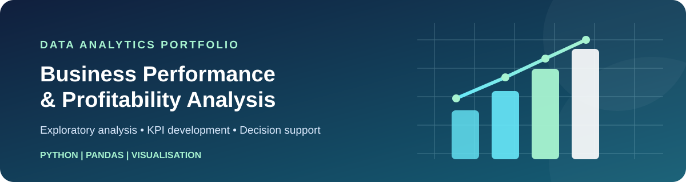
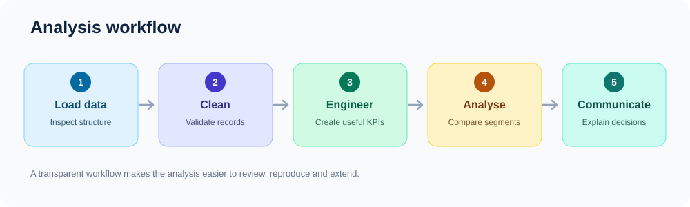
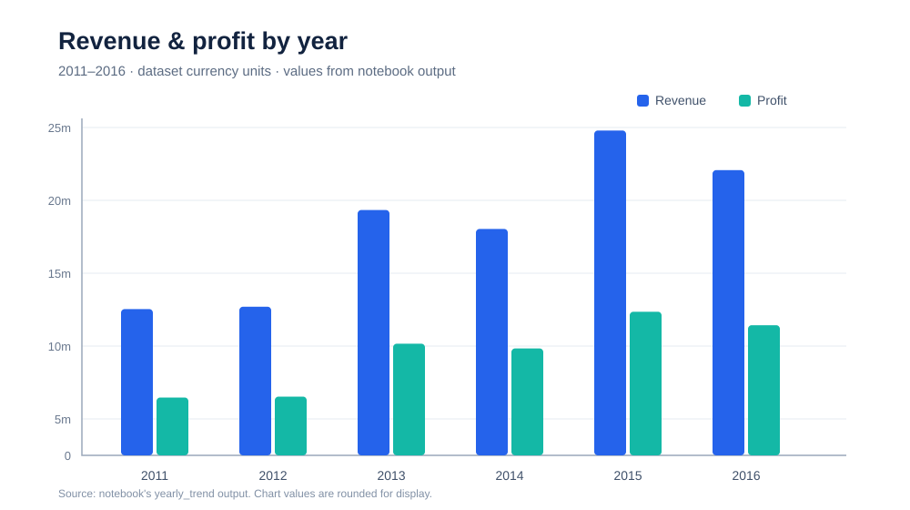
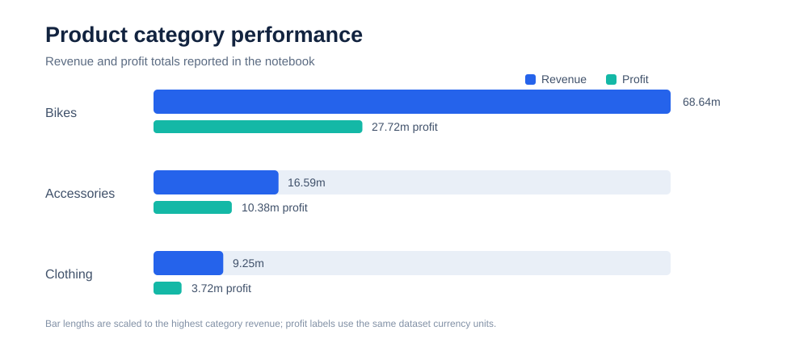

# Business Performance & Profitability Analysis

**Portfolio project | Exploratory data analysis | Business intelligence foundations**

This project explores sales, revenue, cost and profit records to demonstrate a structured analytical workflow: data quality checks, feature engineering, KPI calculation, category comparisons and time-based analysis. It is designed to show how raw transactional data can be translated into interpretable business measures.

> **Scope note:** The notebook contains exploratory analysis. A production-ready executive dashboard and validated business recommendations should only be claimed when those deliverables are included and verified.

## Project snapshot

| Item | Details |
|---|---|
| Main language | Python |
| Libraries | pandas, NumPy, Matplotlib, Seaborn |
| Working environment | Jupyter Notebook |
| Data format | Excel workbook |
| Records | 113,036 initially; 111,858 after removing 1,178 duplicate rows |
| Time coverage in notebook output | 2011–2016 |

## Analytical workflow



1. **Load and inspect** — examine the dataset dimensions, column names and data types.
2. **Validate and clean** — check missing values and duplicate records, then remove duplicate rows.
3. **Engineer features** — create profit margin, month number, quarter, age bands and a high-value-sale flag.
4. **Analyse performance** — calculate summary measures and compare yearly and product-category results.
5. **Communicate findings** — use charts and clearly qualified interpretations to support further business investigation.

## Selected findings from the current notebook

### Annual revenue and profit



The notebook's yearly summary reports the highest annual revenue in **2015** among the displayed years. Revenue and profit both vary over the 2011–2016 period. These patterns are descriptive and do not, by themselves, establish why performance changed.

### Product-category comparison



The current category summary identifies **Bikes** as the largest category by both revenue and profit, followed by Accessories and Clothing.

### Headline metrics reported by the notebook

| Metric | Reported value |
|---|---:|
| Total revenue | 94,483,460 |
| Total profit | 41,819,901 |
| Total order quantity | 1,332,149 |
| Profit divided by revenue | Approximately 44.3% |

Values are shown in the dataset's units; the dataset currency and business context should be confirmed before interpreting these as real-world financial figures. The notebook also calculates the **mean of row-level profit margins**, which is not the same as total profit divided by total revenue. When reporting a business-wide margin, define the calculation explicitly.

## Repository contents

- `REVENUE AND PROFITABILITY ANALYSIS.ipynb` — original analysis notebook.
- `Sales Dataset (1).xlsx` — workbook currently included in the repository.
- `assets/` — project banner, workflow diagram and analytical charts.
- `requirements.txt` — core Python package list.
- `LICENSE` — repository licence.

## How to run the analysis

1. Install Python 3.10 or later.
2. Clone or download this repository.
3. Install the core dependencies:
   ```bash
   pip install -r requirements.txt
   ```
4. Launch Jupyter:
   ```bash
   jupyter notebook
   ```
5. Open `REVENUE AND PROFITABILITY ANALYSIS.ipynb` and run cells in sequence.

**Reproducibility item to address:** the existing notebook loads data from a personal Windows path. Update that cell to use a repository-relative path before expecting the notebook to run unchanged on another computer.

## Quality notes and limitations

- **Dataset provenance:** confirm the original source, permitted use and redistribution licence for the Excel workbook.
- **Data cleaning:** duplicate rows are removed, but the analytical rationale for treating every duplicate as an accidental duplicate should be documented.
- **Feature validation:** inspect the age-band bin boundaries and labels; verify that engineered categories match their intended meanings.
- **Financial definitions:** document currency, profit definition, time aggregation and whether margin is weighted or averaged at row level.
- **Evidence:** figures above are transcribed from the existing notebook's outputs. Re-run the notebook after changes and verify that chart values remain consistent with the calculations.
- **Business recommendations:** make recommendations only after checking segment-level evidence, assumptions and relevant business context.

## Planned enhancements

- Refactor data loading to a portable relative path and separate reusable analysis steps into functions.
- Add automated data-quality assertions and a concise data dictionary.
- Add segment-level analysis by product, region, customer and time where supported by the data.
- Add a clearly documented dashboard only when the dashboard file or reproducible build steps are available.
- Compare forecasting or predictive approaches using an explicit validation design if extending the project beyond descriptive analytics.

## Author

**Godstime Onojeruo**  
MSc Business Analytics · BSc Industrial Mathematics (First Class) · OND Statistics (Distinction)

[GitHub profile](https://github.com/onojeruogodstime-rgb) · [LinkedIn profile](https://www.linkedin.com/in/godstime-onojeruo-a49456aa)

---

*This is an educational and portfolio analysis. Conclusions are limited to the dataset and methods documented in the repository.*
